<!-- GitHub Discussion #117: https://github.com/xg-gh-25/SwarmAI/discussions/117 -->

# How to spend less human attention: an Agent OS built on one brain, many hands

> **In one sentence:** SwarmAI does the work by itself, in parallel on your own cloud machines, driven by one brain of domain knowledge that pulls the judgment out of every session automatically, so each task compounds into the next and needs less of your attention than the last.

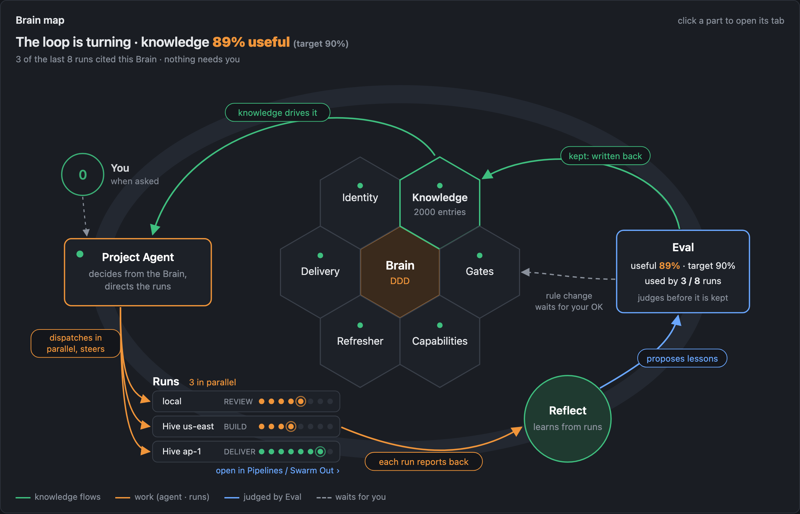

This is the long version of how we think about SwarmAI: the problem we are solving, the design philosophy, the whole solution end to end, the key decisions and what we rejected, and the lessons that cost us the most. It pulls together the [README](https://github.com/xg-gh-25/SwarmAI), the [v2.4.0 release notes](https://github.com/xg-gh-25/SwarmAI/blob/main/docs/releases/v2.4.0.md) (#115, #116) and the design docs behind them.

**Contents**

1. The problem: attention, not ability
2. The design philosophy: one brain, many hands
3. The overall solution
4. Where attention goes, and what removes it
5. Key decisions, and what we rejected
6. Lessons learned
7. What is still open
8. Questions for you

---

## 1. The problem: attention, not ability

The scarce resource in agent work is no longer what an agent can do. Agents can write code, research and work for hours on their own. **What breaks is the person around them.**

- One more chat tab to watch.
- One more approval to click.
- One more result to check line by line.
- One more agent that forgot what the last one learned, so you explain the context again.
- One more mistake you already corrected last week.

A team of agents often makes this worse, not better: the person becomes the team's dispatcher, its reviewer and its memory. More agents means more of you, not less.

So the question we design against is not "how capable is the agent?" but:

> **After this task, does the system need less of you than before it?**

If the answer is yes, every task compounds. If the answer is no, you have built a faster way to fill your day with supervision. **SwarmAI turns every task into lasting cognition, and lasting cognition into increasingly autonomous delivery.**

---

## 2. The design philosophy: one brain, many hands

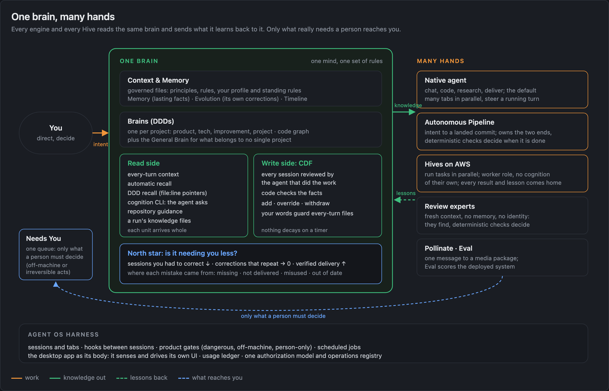

SwarmAI has **one brain**. This is a deliberate choice against "many brains", the common design where every agent in a team carries its own memory and its own role.

- **One cognitive system, many scoped Brains.** Each project has a **Brain**: its domain knowledge kept as one standard set of documents (we call it a DDD). A built-in **General Brain** holds what belongs to no single project. They are the knowledge of one mind, with one set of rules for how knowledge is written, checked and used.
- **The brain learns from every session by itself.** When a session ends, the agent that did the work reads back its own record and declares what changed its judgment: a correction you made, a decision, a lesson, a pitfall. A learning pipeline (CDF, the Cognitive Distillation Flow) checks the facts behind each one and files it in the right place. Nobody has to say "remember this".
- **Everything else is a hand.** The chat agent, the autonomous pipeline, the cloud workers (Hives) and the review experts all read the same brain and send what they learn back. A Hive writes no cognition of its own. A review expert starts with fresh context and keeps no memory, which is exactly what keeps it an honest critic.
- **Why one brain.** Compounding needs one place where value adds up. With many brains, knowledge splits and drifts, every hand-off loses context, and the person ends up as the integrator. With one brain, a lesson learned on any Hive improves the next task everywhere, there is one place where things wait for you, and one set of numbers says whether it is getting better.

The principles that follow from it:

1. **One brain, many hands.** Division of labor between minds is a workaround for limited human bandwidth, not good design. Single agent, many roles, one knowledge layer.
2. **Attention is the scarce resource; compounding is the goal.** Every task should leave the system needing less of you.
3. **The model proposes, the OS disposes.** The agent with the context decides the meaning; code checks facts; a gate decides from a test, an exit code, a diff or a person's decision, never from a model's opinion of its own work.
4. **Evolution is cognitive, not data.** One edited line in a principle file shifts judgment more than a thousand memory rows, and every change is a `git diff`. A recurring error class gets a structural fix, not one more logged lesson.
5. **The brain holds only what is in force.** Knowledge changes by add, override or withdrawal, decided when the new knowledge arrives. Nothing leaves on a timer, and nothing is cut to fit a budget.
6. **Quality converges through deterministic checks.** Carefulness does not scale; checks do. Reviews find, tests decide, and review rounds stop at a cap.
7. **If you can't measure it, you didn't build it.** Less correction, less repetition, more verified delivery.

The thesis behind all of it: **one builder + AI + a self-evolving system can deliver at team scale**, in code and in everything else. SwarmAI is that experiment, and the repository is its evidence.

---

## 3. The overall solution

```
┌──────────────────────────────────────────────────────────────────────┐
│  HANDS        Native agent · Autonomous Pipeline · Hives (Swarm Out)   │
│               Review experts · Pollinate · Eval                        │
├──────────────────────────────────────────────────────────────────────┤
│  ONE BRAIN    Context & Memory · Brains (DDDs) + General Brain         │
│               Write side (CDF) · Read side (recall, cognition)         │
├──────────────────────────────────────────────────────────────────────┤
│  HARNESS      Sessions & tabs · Hooks · Product gates · Jobs           │
│               Desktop body · Authorization & operations registry       │
└──────────────────────────────────────────────────────────────────────┘
```

The loop has three moves, and they only compound together: **Brain-driven → autonomous and parallel → cognitive self-evolution**, and back into a better Brain.

### 3.1 Brain-driven: the Brain decides the work

Every Brain has the same six sections, for any domain: **Identity · Knowledge · Gates · Capabilities · Delivery · Refresher**. It governs `0..N` assets: a code repo, a data source, a document corpus, or nothing at all. A pure-knowledge Brain is complete, not degraded.

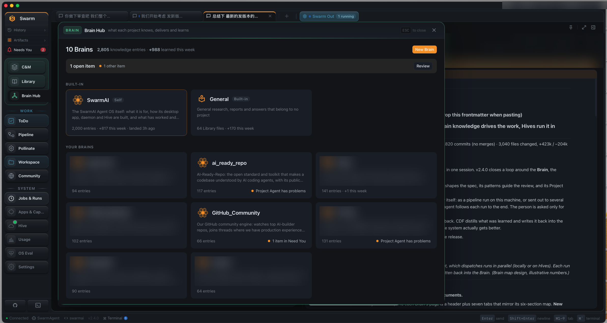
*Brain Hub: every Brain, what it knows and what it learned this week. (Private Brain names are blurred.)*

- **Project Agent.** Each Brain carries one standard definition of how its work runs: which repos, which mode, which limits. Dispatch reads it, so "which Brain, which mode" is a default, not a question to you.
- **Code intelligence builds itself** once a Brain has a repo. Reviews see which callers a change can break, and a pre-commit check refuses a staged change that breaks a caller.

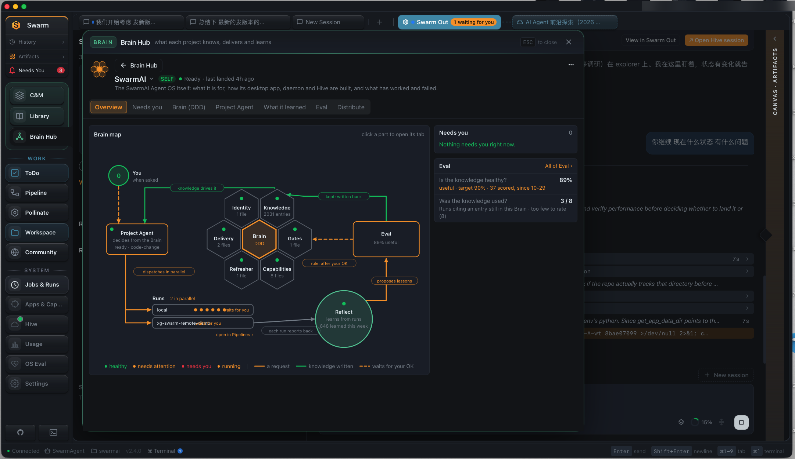
*A Brain's page: the loop drawn with live data, with runs under way in parallel.*

**The Autonomous Pipeline** is the optional delivery mode for code. It owns the two ends: the front end understands the need, the back end guards quality. The middle, how the code is written, is the agent's call.

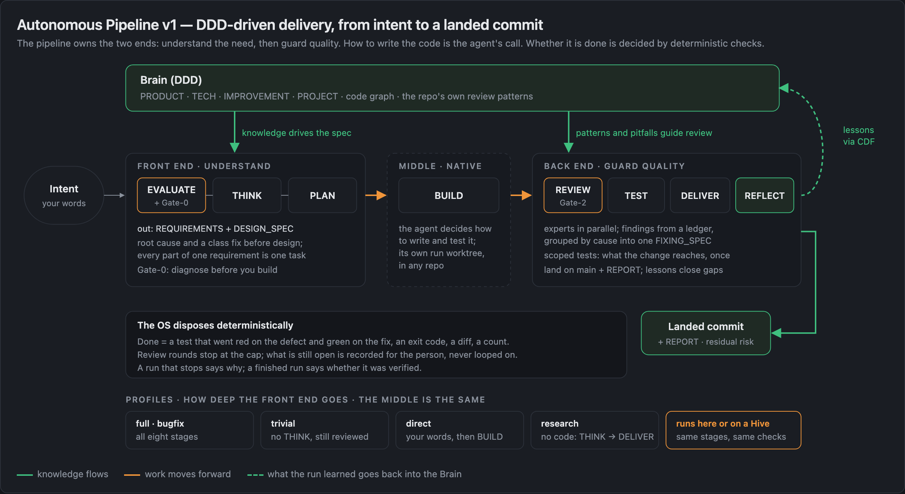

- **Profiles** set how deep the front end goes: `full`, `bugfix`, `trivial`, `direct` (your words, then build) and `research` (no code). The middle is the same for all of them.
- **Every link has its own check:** the intent by the requirements and Gate-0 (diagnose before you build), the change by a test that fails on the defect and passes on the fix, the result by expert review (Gate-2), and what the run learned by REFLECT, which turns it into a lesson or a closed gap.
- **Each run gets its own worktree** and lands automatically while main keeps moving.
- **Review converges.** Findings come from a ledger, are grouped by cause into one fixing spec, and review stops at the cap. What is still open is recorded as residual risk for the person, never looped on.

### 3.2 Autonomous, in parallel, in the cloud: Swarm Out

A **Hive** is your own SwarmAI running on an AWS machine, used as a worker. **Swarm Out** sends one sentence of work to a Hive and brings everything home.

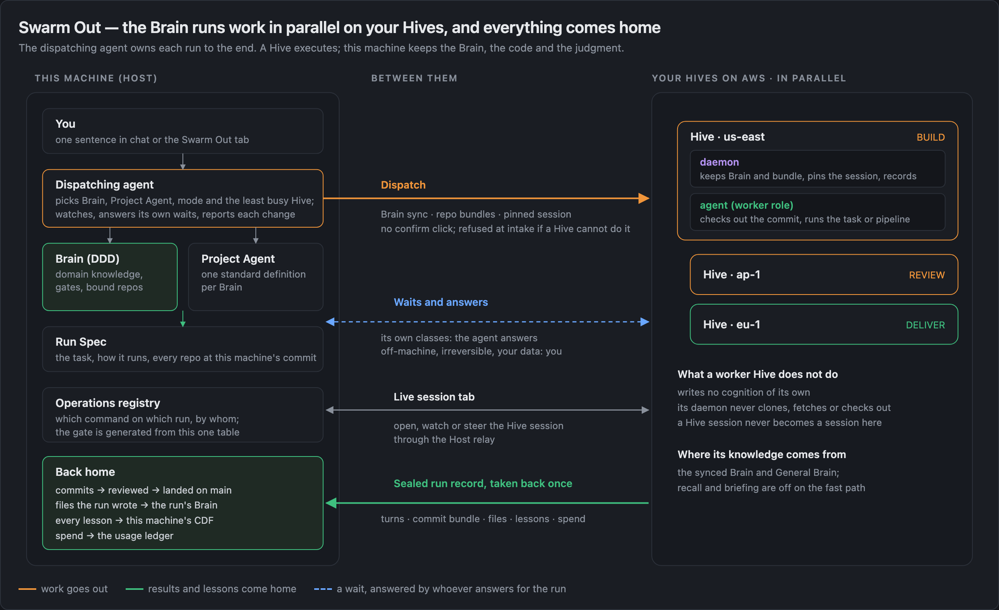

- **Dispatch without a confirm click.** The agent picks the Brain, the Project Agent, the mode and the least busy Hive.
- **The Hive works on your machine's code**: your machine's commit of every repository in its Brain.
- **Everything comes home in one sealed run record**: commits as a bundle that is reviewed, then landed; files into the run's Brain; every lesson into your machine's CDF; spend into one usage ledger.
- **The agent that dispatched a run owns it to the end.** It watches, posts one line per change, answers the waits it is allowed to answer, and leaves anything off-machine, irreversible or touching your data to you.
- **Parallel runs add up instead of overwriting.** Every Hive run should know which version of the Brain it worked from, so its lessons are judged against that version when they come home.

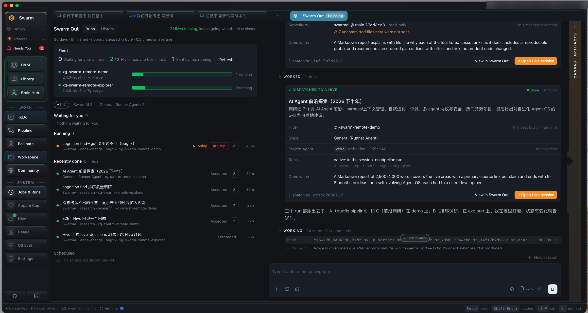
*The pinned Swarm Out tab: the fleet, what is running and what came back, and the dispatching chat.*

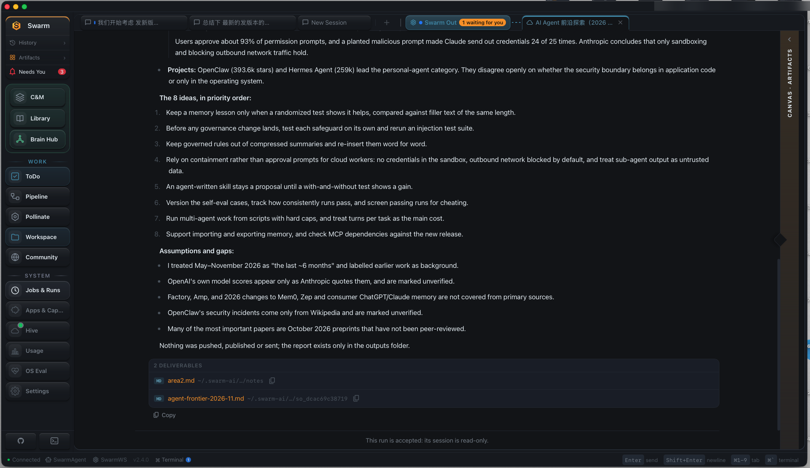
*A Hive's own session, opened as a tab on this machine. Once the result is accepted, the session turns read-only.*

### 3.3 Cognitive self-evolution: the write side

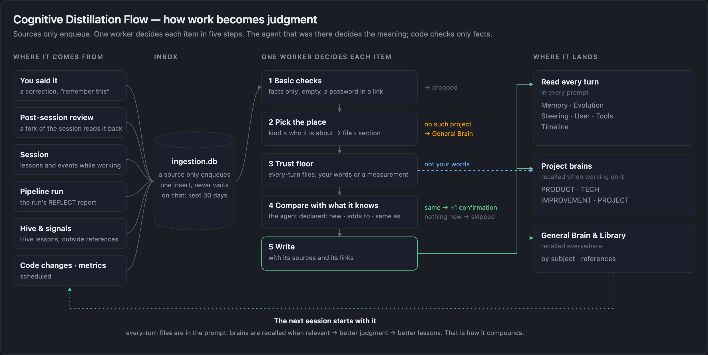

- **One flow, many doors.** Sessions, post-session reviews, pipeline runs, Hive runs, outside signals and code changes all enqueue into one inbox. A source only enqueues; one worker decides each item in five steps: basic checks, pick the place, trust floor, compare with what it knows, write.
- **The agent with the context decides; code checks facts.** The agent that produced a unit declares what it is (new, adds to, same as, replaces, repeats a correction). Code checks that the evidence exists, the target exists, and there is no secret or injected text.
- **The brain holds only what is in force.** Every change is an add, an override or a withdrawal. History is kept outside the main files. A withdrawal does not come back.
- **Validity is checked without timers.** New commits are scanned and an entry the code has made false is retired; a judge that took no part in writing scores samples of what was kept; every real mistake is traced to whether stale knowledge caused it.
- **A trust floor for every-turn files.** Only your own words or a measurement may enter the files read in every session. Anything else goes to a project Brain or the General Brain, moved, never dropped.
- **Mistakes become a ledger.** You pick a correction's class; the repeat rate is a count, not a model's guess.

### 3.4 Cognitive self-evolution: the read side

Writing knowledge down is half of it. The other half is putting the right piece in front of the agent at the moment it decides.

| Door | When it fires | What arrives |
|---|---|---|
| **Every-turn context** | Every session, assembled fresh | Principles, rules, your profile, Memory and Evolution in full, recent activity, the north-star headline |
| **Automatic recall** | Session start and new messages | Relevant Library knowledge and past sessions (keyword / FTS5 / BM25, no vector store) |
| **DDD recall** | When the project is detected (ambiguous means none) | Pointers (`file:line`) to the Brain entries that bear on the task, so the agent reads the source |
| **`cognition` CLI** | Whenever the agent decides it needs to know | A search of every store (Brains, Knowledge, Memory, Evolution, Timeline, past sessions, the code graph) with the words of the solution |
| **Repository guidance** | The first time a session touches a repo | The repo's own `AGENTS.md`, review patterns and lessons from earlier runs |
| **A run's knowledge files** | At create and after EVALUATE | Product and decisions for EVALUATE; tech, improvement and lessons for THINK and PLAN; project knowledge for the reviewer; ids the documents must cite |

**Every unit arrives whole:** recall decides which entries to show, never how much of one. Because the every-turn files are injected whole, their size and the time to first token are measured, and entries are consolidated when they grow, never cut.

### 3.5 Authorization: whoever dispatches answers for the work

Autonomy only works if it is always clear who may decide what.

- **Authority follows delegation.** A person answers for what they run or dispatch. An agent that dispatches workers answers for them, records each decision as its own (never as yours), and escalates what it cannot handle. It may never decide more than it could do itself without asking.
- **Every wait carries an approval class**, computed by the gate that stopped the work. The dispatching agent may answer only the agent classes, only through the CLI, and only with an option on a card it built for that very wait. Anything unclear fails closed to a person-only class.
- **One registry of operations.** Every Swarm Out and Hive operation is one row that says who may call it; the agent-side gate is generated from the table, and a test fails if a route has no row.
- **Full authority, guarded acts.** The agent keeps your full authority over your own work. What is guarded is the dangerous, the irreversible, the off-machine, and content from outside that tries to act as an instruction.

### 3.6 The harness: the body the brain lives in

- **Sessions don't start cold.** Hooks fire between sessions; the system prompt is rebuilt from the governed files every time.
- **One fact for "a turn is in progress"**, kept in the backend. The busy indicator follows real activity; after 45 seconds of quiet the turn says what it is waiting on.
- **Steer.** A message sent while a turn runs goes into that turn.
- **The desktop app is its body.** The agent senses what you see (which panel is open, what is on the Canvas) and acts on it.

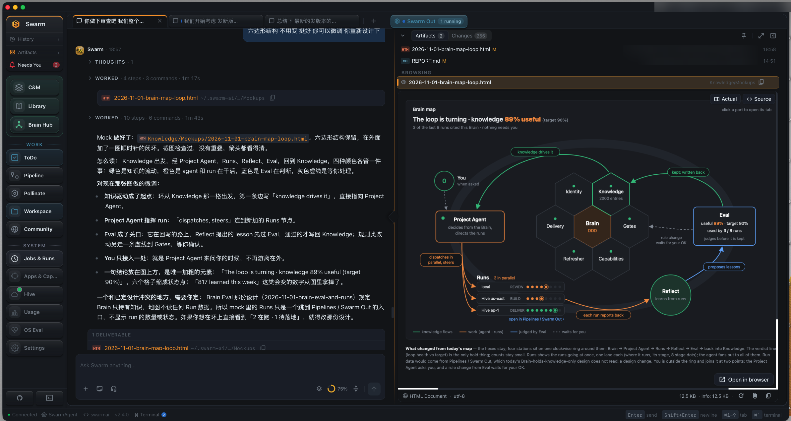
*A finished turn folds its process into short rows and ends with its deliverables; the Canvas shows the session's files and changes.*

### 3.7 Measuring it: less correction, less repetition, more verified delivery

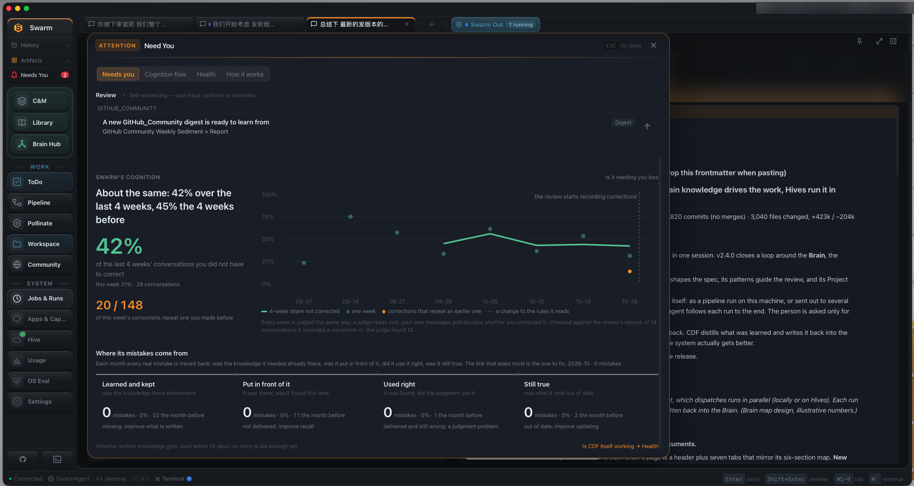
*Is it needing you less, and where its mistakes come from: missing knowledge, knowledge not delivered, knowledge misused, or knowledge out of date.*

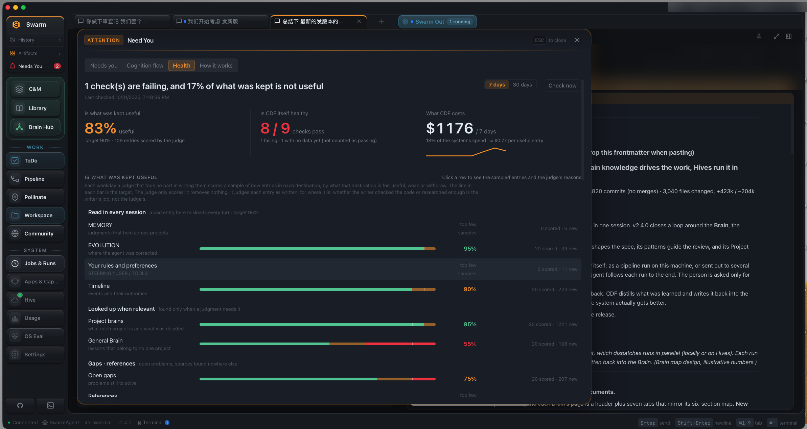
*Is what the brain keeps worth keeping, is the learning pipeline healthy, and what it costs.*

Having nothing to correct is not the same as being right, so delivery has to be verified, not just uncorrected.

---

## 4. Where attention goes, and what removes it

| Where your attention goes | What removes it |
|---|---|
| **Re-explaining context** every session | One brain: every-turn context, recall, DDD pointers, and the agent's own `cognition` search |
| **Correcting the same mistake** again | The brain learns from every session; a repeated correction is counted; a recurring class gets a structural fix |
| **Watching a turn** to see if it is stuck | One backend fact for "in progress"; the turn says what it waits on; Needs You collects what really waits on you |
| **Clicking approvals** | Approval classes: the agent answers what it may; prompts appear only for what the command does not answer itself |
| **Checking results** line by line | Deterministic checks decide done; the run says whether it was verified and what risk is left |
| **Dispatching** and choosing where | Defaults from the Brain and Project Agent; the least busy Hive; no confirm click |
| **Integrating** what many agents produced | One brain; the dispatching agent owns each run; everything comes home and lands reviewed |
| **Wondering** whether it is getting better | The north star in every prompt, and the cognition and health panels |

---

## 5. Key decisions, and what we rejected

| Decision | Why | What we rejected |
|---|---|---|
| **One brain, single agent switching roles** | No hand-off cost, no knowledge split; a lesson learned anywhere improves everything | Multi-agent teams with their own memories inside one task |
| **The agent with the context decides; code checks facts** | The agent that did the work has the whole session in view; a later judge sees less and second-guesses | A separate model judge that re-decides every unit |
| **Value first: no write quota, no injection budget, no truncation** | A cut unit is a rule the agent never sees; cutting silently changes judgment | Size caps that trim memory to fit a budget |
| **The brain holds only what is in force** | A store full of stale entries misleads; a store that forgets by age loses what still matters | Time-based decay of knowledge |
| **Native by default, pipeline when you choose** | Small changes should not pay for ceremony; risky ones get one question | A pipeline or gate that every change must pass |
| **Gates only where every user benefits** | Dangerous, off-machine, person-only and session-protecting cases; normal work always has a way through | Gates that block native coding, testing or committing |
| **Pipeline owns the two ends; deterministic checks decide** | A model's verdict is not reproducible; a loop waiting for models to agree has no end | Review loops that run until reviewers stop finding things |
| **The dispatching agent owns its runs** | Background work that nobody follows becomes your work | "Reply one line after dispatch and let the person read the panel" |
| **Hives are hands with no cognition of their own** | Two places that learn means two brains that drift | Each worker keeping its own memory |
| **Remove the cause, not add a timeout** | A timeout, retry or catch-and-continue makes the system look healthy while the cause stays | Watchdogs and cooldowns as fixes |
| **Recovery preserves, never destroys** | Data loss is unbounded and irreversible; a crash loop is bounded | Auto-reseed or delete of a store that "looks corrupt" |

---

## 6. Lessons learned

Each of these happened. They are why the decisions above look the way they do.

**1. The most dangerous failure is the one that looks like success.**
A performance change introduced a name error inside the system-prompt assembly. One broad `try/except` around the whole assembly swallowed it, so every new session ran for about 34 hours with nearly none of its principles and rules, and nothing alerted. The agent just quietly got worse. **Lesson:** assembly code must isolate each part so one failure cannot take the core with it, must fail loud, and must check that the core sections are actually present. All three are now in the prompt builder.

**2. Recovery must preserve, never destroy.**
A user database was wiped with no backup and no approval. Worse, our first two root-cause stories were wrong: we blamed a recovery path because the timing matched, but the logs that covered that hour showed the path never ran. **Lessons:** the heaviest irreversible act must never be triggered by the weakest signal, so a store that looks corrupt is now isolated (renamed, never deleted) and the destructive step waits for a person; and "the timing matches" is not evidence that something ran. Grep for its signature first.

**3. Removing a safety net means replacing what it hid.**
We removed a kill-and-respawn path for a tool-call glitch, which was the right direction (no disaster recovery as a fix). But that path had been hiding a user-visible result: a broken turn got silently replaced. Without it, turns dead-ended. **Lesson:** when you remove a recovery mechanism, answer what now takes its place for the person. The fix continues the turn in the same process and cleans the glitch out of the transcript so it is not replayed.

**4. A model loop needs a counter, or it never ends.**
In one run, every fix after the second review round triggered a new review, and each review found something new: five rounds, trading one medium finding for another. **Lesson:** the second round is the last; what is still open is recorded, not fixed in the same run. Review rounds and decisions now have caps held by a counter.

**5. Making the person your control loop is a failure, even when it feels careful.**
Handing back decisions the agent could make ("do you approve…?", "should I run…?") and adding checks to feel safe both seek confidence outside the work. **Lesson:** decide the verification up front, run it, report what it found. Ask only for intent you cannot read one way, or for an irreversible or off-machine act.

**6. Background work that nobody follows becomes the person's work.**
Runs were dispatched to Hives, then left for the person to watch, accept, discard and re-send. **Lesson:** whoever dispatches follows the work to the end. This became the "dispatching agent owns its runs" rule and the approval classes behind it.

**7. Fix the cause of slowness, not its symptom.**
The learning pipeline was starved all day by a rule that paused it while any chat was streaming, and chat was still slow. The real cause was a quadratic function: parsing one large Brain file took about a second. Making it linear brought that to about 23 ms, and the pause rule could simply be deleted. In the same spirit, a regex that was quadratic on hostile input (seconds of a frozen event loop) became linear (milliseconds).

**8. A metric is a proxy; check the thing it stands for.**
We once shrank an oversized store and called it fixed. Asking why so much was written showed a quadratic re-extraction and hundreds of duplicate entries in a Brain, damage the size fix never touched. **Lesson:** before reporting a store fixed, name what produces its contents.

**9. A brain is only as good as its weakest door.**
Knowledge enters through many doors (chat, runs, Hives, signals). Changing the rules of one door while the others keep the old rules makes the brain disagree with itself. **Lesson:** any change to how knowledge is admitted is reasoned across all doors at once. This is why everything now goes through one inbox and one worker.

**10. A gate that is too strict gets removed, and then protects nothing.**
Security checks that fail on legitimate setups force people to delete them. **Lesson:** test a check both ways: a real violation must still be blocked, and a legitimate user must be able to keep it.

**11. A product rule must work for every user, not just for us.**
Several gates once blocked normal coding and committing, tuned to our own repo. They helped us and hurt everyone else, so they were removed. **Lesson:** strip out this user, this machine and this repo; if the capability no longer works or no longer helps, it is not product. A repo's own discipline belongs in that repo's own files.

**12. Measure the distribution before naming the cause of your own behavior.**
A striking example of our own output looked like an obvious cause. Measuring across all cases told a different story. **Lesson:** one vivid example is an inference wearing an observation's clothes, especially when the example is your own.

---

## 7. What is still open

- **Brain versions for parallel Hives.** Every Hive run should record which version of the Brain it worked from, and its lessons should be judged against that version when they come home.
- **Verified delivery as a first-class number**, next to corrections and repeats.
- **A harder boundary for person-only actions.** Today the agent-side gate stops mistakes and casual misuse; a person-signature step is designed for the case where it must hold against a determined agent.
- **Fewer places that wait on you**, until the only things left are the ones only a person can decide.

---

## 8. Questions for you

1. If you run several agents today, where does your attention actually go? Which row of the table in section 4 is your biggest cost?
2. One brain or many brains: where would you draw the line in your own work?
3. What would you need to see before you let an agent land code without you watching?
4. Which of the lessons above have you hit yourself, and what did you do about it?

---

**Read more:** [README](https://github.com/xg-gh-25/SwarmAI) · [v2.4.0 release notes](https://github.com/xg-gh-25/SwarmAI/blob/main/docs/releases/v2.4.0.md) · [Thesis](https://github.com/xg-gh-25/SwarmAI/blob/main/docs/THESIS.md) · [Design docs](https://github.com/xg-gh-25/SwarmAI/tree/main/docs/design) · [AGENTS.md](https://github.com/xg-gh-25/SwarmAI/blob/main/AGENTS.md)

<details>
<summary><b>中文摘要：怎么减少人的注意力 —— 一个大脑、多双手的 Agent OS</b></summary>

**一句话：** SwarmAI 自己把活干完，在你自己的云端机器上并行地跑；驱动它的是一个装着领域知识的大脑，这个大脑会自动从每个 session 里提取判断力。于是每个任务都为下一个任务积累复利，一个比一个更少占用你的注意力。

**问题。** 稀缺的已经不是 agent 能做什么，而是人的注意力：盯 tab、点审批、查结果、重复讲上下文、重复纠正同一个错。一队 agent 往往更糟，人成了它们的调度员、审核员和记忆。我们设计时只问一个问题：做完这个任务，系统是不是比之前更少需要你？

**设计哲学：一个大脑，多双手。** 多个按领域划分的 Brain 是同一个认知系统；大脑自己从每个 session 里学；chat agent、pipeline、Hive、审查专家都是手。复利需要一个能累加价值的地方，多脑只会让知识分裂、让人变成整合者。

**整体方案。** Brain 驱动（六段式 Brain、Project Agent、只管两头的 Pipeline）；自主执行、云端并行（Swarm Out，派单的 agent 负责到底，产出全部带回）；认知自进化（写入侧 CDF：带上下文的 agent 判断、代码核对事实、只保留当前有效的知识；读取侧：每轮 context、recall、DDD recall、`cognition` CLI、仓库规则、run 的知识文件）；授权（谁派单谁负责、审批类别、操作登记表）；度量（纠正更少、重复更少、通过验证的交付更多）。

**关键决策。** 一个大脑而不是多脑；带上下文的 agent 判断，不要事后再判；价值优先，不设配额、不截断；大脑只保留当前有效的知识，不按时间淘汰；默认原生，pipeline 由人选；gate 只放在对每个用户都有益的地方；确定性检查判定完成，评审轮数有上限；派单的 agent 跟到底；Hive 是手，不留认知；修根因，不加超时；恢复只保全，不销毁。

**经验教训（都真实发生过）。** 看起来成功的静默降级最危险；恢复只能保全不能销毁，"时间对得上"不等于"真的跑过"；去掉安全网要补上它掩盖的东西；模型循环必须有计数器；把人变成控制回路是失败；没人跟进的后台工作会变成人的工作；修慢的根因而不是症状；指标是代理，要查它代表的东西；大脑的质量取决于最弱的那道入口；过严的 gate 会被删掉；产品规则必须对每个用户都成立；给自己的行为下结论前先看分布。

</details>

🐝 Generated with SwarmAI
