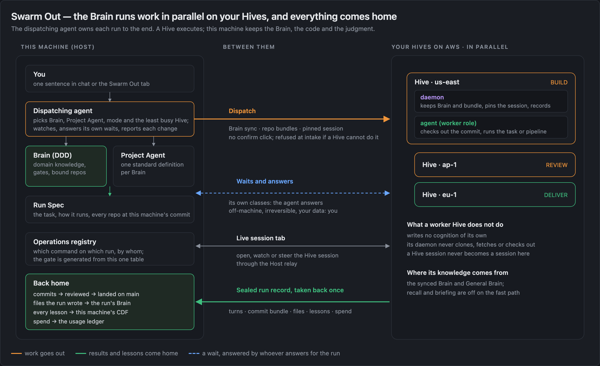

# Release v2.4.0 — Brain-driven autonomy: domain knowledge drives the work, Hives run it in parallel, cognition evolves itself

**Range:** [`v2.3.0...v2.4.0`](https://github.com/xg-gh-25/SwarmAI/compare/v2.3.0...v2.4.0) · 2026-10-15 → 2026-11-01 · 1,820 commits (no merges) · 3,040 files changed, +423k / −204k lines · 98 new design documents under [`docs/design/`](https://github.com/xg-gh-25/SwarmAI/tree/main/docs/design).

## The theme of this release

Before v2.4.0, SwarmAI was a strong agent on one machine, in one session. v2.4.0 closes a loop around the **Brain**, the domain knowledge of a project (its DDD):

1. **Brain-driven.** The Brain decides the work. Its knowledge shapes the spec, its patterns guide the review, and its Project Agent says how a task should run.
2. **Autonomous, in parallel, in the cloud.** The work runs by itself: as a pipeline run on this machine, or sent out to several Hives (your SwarmAI on AWS) at once. The dispatching agent follows each run to the end. The person is asked only for what only a person can decide.
3. **Cognitive self-evolution.** Every run and session reports back. CDF distills what was learned and writes it back into the Brain, and three north-star numbers measure whether the system actually gets better.

The next task then starts from a better Brain. That loop is the release.

*The loop around a Brain: knowledge drives the Project Agent, which dispatches runs in parallel (locally or on Hives). Each run reports back, the lessons are judged, and what is kept is written back into the Brain. (Brain map design, illustrative numbers.)*

---

## 1 · Brain-driven: the Brain decides the work

**A Brain is a first-class product object, not a folder of documents.**

- **Brain Hub** has a layered home, and each Brain's page is a header plus seven tabs that mirror its six-section map. **New Brain** works end to end and fails early. It creates a standard initial DDD plus a Project Agent.
- **Two built-in Brains: SwarmAI and General.** The General Brain holds cross-project knowledge and is read in every project. A Brain holds knowledge only; runs belong to where they execute.
- **Project Agent: one standard definition per Brain**, confirmed by the agent itself, keeping only what a run uses. Dispatch reads it, so "which Brain, which mode" is the agent's default, not a question to the person.
- **Knowledge has an address.** [`SWARMAI.md`](https://github.com/xg-gh-25/SwarmAI/blob/main/backend/context/SWARMAI.md) says where each kind of knowledge lives and how to fetch it. **`cognition find / get / map`** is one read entrance for the whole brain: Brains, `Knowledge/`, MEMORY, EVOLUTION with archives, Timeline, context files, past sessions and the code graph.
- **Code intelligence is automatic once a Brain has a repo.** There is one way to build and update the graph. Python and Java get typed receivers and a "will break" check, the callers report reaches every review round and every Hive, and a pre-commit check refuses a staged change that breaks a caller.
- **Recall measures itself** (precision, coverage, follow-up budget). **DDD drift is fixed automatically** where the fix is certain, and the report says what was found and what was fixed.

Design: [built-in Brains and the Project Agent standard](https://github.com/xg-gh-25/SwarmAI/blob/main/docs/design/2026-10-29-default-brains-and-project-agent-standard.md) · [knowledge addressing](https://github.com/xg-gh-25/SwarmAI/blob/main/docs/design/2026-10-28-knowledge-addressing.md) · [the `cognition` entrance](https://github.com/xg-gh-25/SwarmAI/blob/main/docs/design/2026-11-01-cognition-entrance.md) · [code intel unification](https://github.com/xg-gh-25/SwarmAI/blob/main/docs/design/2026-10-29-code-intel-unification.md)

### Autonomous Pipeline v1: DDD-driven delivery from intent to a landed commit

The pipeline was rebuilt around one rule: **it owns the two ends.** The front end understands the need (EVALUATE with Gate-0, THINK, PLAN → requirements and design spec). The back end guards quality (REVIEW with Gate-2, TEST, DELIVER, REFLECT). How the code is written is the agent's call. Whether it is done is decided by deterministic checks.

- **New event protocol and read model.** Commands run locally and the event log is checksummed.
- **Profiles set how deep the front end goes:** full, bugfix, trivial, direct (your words, then BUILD) and research (no code). The middle is the same for all of them.
- **Each run gets its own worktree** in any repo, and isolated runs land automatically while main keeps moving.
- **Deterministic convergence.** Gate-2 findings come from a ledger and are grouped by cause into one FIXING_SPEC. Review experts have their own agent type and a call cap and run in parallel. Rounds stop at the cap, and what is still open is recorded as residual risk for the person, never looped on.
- **Honest endings.** A run that stops says why, and a finished run says whether it was verified. Tests red on main are registered instead of lost. A person can answer, stop or resume a run, and the agent never answers for them.
- **REFLECT feeds the Brain.** A run's lessons go to CDF, and a run closes the gaps it fixed.

Design: [the pipeline owns the two ends](https://github.com/xg-gh-25/SwarmAI/blob/main/docs/design/2026-10-26-pipeline-two-ends.md) · [review convergence](https://github.com/xg-gh-25/SwarmAI/blob/main/docs/design/pipeline-review-convergence.md) · [one worktree per run](https://github.com/xg-gh-25/SwarmAI/blob/main/docs/design/pipeline-run-worktree.md)

---

## 2 · Autonomous, in parallel, in the cloud: Swarm Out

**One sentence in chat becomes a run on a Hive, and everything it produced comes home.**

- **A pinned Swarm Out tab** at the right end of the tab row. On the left is a live dashboard: the fleet, numbers, and run cards that trace Brain → Agent → Context → Hive → Report. On the right is a real chat session. The tab shows "N running / N waiting" badges, and the hive icon breathes while work is in flight.
- **Dispatch without a confirm click.** The agent picks the Brain, the Project Agent, the mode and the least busy Hive. A task a Hive cannot do is refused at intake.
- **The Hive works on this machine's code.** A task runs on this machine's commit of every repository in its Brain. The Hive daemon only keeps the bundle, and only the agent touches git.
- **Everything comes home in one sealed run record.** Commits come back as a bundle that is reviewed, then landed. Files the run wrote go into the run's Brain, every lesson goes straight into this machine's CDF, and the spend goes into the usage ledger.
- **The dispatching agent owns its runs.** It watches, posts one line per run change, gives a digest before your next message, and answers the Hive's waits for its own classes. Anything off-machine, irreversible or touching your data still goes to you. Its commands are checked against the run, not against its word.
- **Run review at scale.** One run card everywhere, a run list, a big card and a five-command panel. One **operations registry** decides which command is allowed on which run and by whom, and the gate is generated from it.
- **A live Hive session tab** (Host proxy and relay) lets you open, watch or steer the remote session. A Hive pipeline run's decision reaches the Host.
- **History answers "is dispatched work reliable?"** It groups runs by Brain or Project Agent, shows how much came back done unattended, and draws one autonomy line over the last 30 days.
- **Worker Hives stay clean.** A worker Hive writes no cognition of its own, inherited cognition is set aside once, and recall and briefing are off on the fast path.
- **Zero-touch from New Brain to a finished Hive run**, plus seven E2E fixes for places a run could get stuck with no way out.

**The cloud side is usable by anyone with an AWS account.** A connect wizard sets up one pinned SwarmAI AWS account through `credential_process`, and the daemon, Bedrock and every Hive use it. An expired sign-in is fixed in one click from Settings. Bedrock model ids follow the main region (`eu-*` → `eu.`, `ap-*` → `apac.`, others → `global.`). A platform-wide **usage ledger** counts every token and dollar, including Hive spend and each pipeline run's share.

Design: [Swarm Out](https://github.com/xg-gh-25/SwarmAI/blob/main/docs/design/2026-10-27-swarm-out.md) · [the dispatching agent owns its runs](https://github.com/xg-gh-25/SwarmAI/blob/main/docs/design/2026-10-31-swarm-out-agent-owns-its-runs.md) · [zero-touch Brain to Hive](https://github.com/xg-gh-25/SwarmAI/blob/main/docs/design/2026-11-01-brain-to-hive-zero-touch.md) · [one SwarmAI AWS account](https://github.com/xg-gh-25/SwarmAI/blob/main/docs/design/2026-10-31-swarmai-aws-account.md) · [usage ledger](https://github.com/xg-gh-25/SwarmAI/blob/main/docs/design/2026-10-29-usage-accounting.md)

---

## 3 · Cognitive self-evolution: CDF

*The flow diagram shipped in Needs You → How it works, rendered from the app's own component.*

**CDF replaces the old memory and cultivation paths with one flow. The agent with the context decides; code checks facts.**

- **One flow, many doors.** Chat sessions, post-session reviews, pipeline runs, Hive runs, outside signals and code changes all enqueue into one inbox, and one worker decides each item in five steps. The old v1 pipeline, the legacy DDD cultivation path, the artifact registry and the signal-to-DDD bridge are deleted.
- **Each session is reviewed by its own agent and model, from its own record.** The producing agent declares what a unit is (new, adds to, same as, replaces, repeats a correction). CDF checks facts: the evidence exists, the target section exists, and there is no secret and no injected text. The second-guessing verify judge is gone.
- **Brain-driven files.** A Brain's main files are the current valid whole. Every change is an add, an override or a withdrawal, decided when the knowledge arrives, and history is kept outside the main files. A withdrawal does not come back.
- **Value first, no budgets.** There is no write quota and no injection budget, and MEMORY and EVOLUTION are injected whole. Size is kept down by declarations (same → one more confirmation, replaces → the old entry leaves), never by cutting.
- **A trust floor for every-turn files.** Only your own words or a measurement may enter MEMORY, EVOLUTION, Steering, User or Tools. Anything else is moved to a project Brain or the General Brain, never dropped.
- **Lessons compound.** The General Brain is found again in every project, a repeated lesson reaches EVOLUTION, and a gap closes when an event says it is done. Open work becomes a ToDo instead of a "Next" line.
- **Mistakes become a ledger.** The person picks a correction's class, and the repeat rate is a count, not a model's guess. A sent-back Hive delivery counts as a correction too.
- **You can see it work.** Needs You has a **Cognition flow view** (what landed, where, through which step), a **Health tab** (is what CDF keeps useful, is CDF healthy, what it costs) and **Swarm's cognition level**. Brain Hub has a **change feed** (what a Brain learned, read from CDF's records instead of git).
- **The north star is in every prompt.** It tracks three measures: how often the person corrected me, how often a correction repeats, and where mistakes come from. They are defined in [`SWARMAI.md`](https://github.com/xg-gh-25/SwarmAI/blob/main/backend/context/SWARMAI.md), shown as a headline in every prompt, and the detail is one command away ([`scripts/north_star.py`](https://github.com/xg-gh-25/SwarmAI/blob/main/backend/scripts/north_star.py)). Progress means fewer corrections and fewer repeats, not more stored entries.

Design: [Cognitive Distillation Flow](https://github.com/xg-gh-25/SwarmAI/blob/main/docs/design/2026-10-26-swarm-cognitive-distillation-flow.md) · [the agent with the context decides](https://github.com/xg-gh-25/SwarmAI/blob/main/docs/design/2026-10-30-cdf-agent-decides.md) · [Brain-driven files](https://github.com/xg-gh-25/SwarmAI/blob/main/docs/design/2026-10-30-brain-driven.md) · [CDF health](https://github.com/xg-gh-25/SwarmAI/blob/main/docs/design/2026-10-31-cdf-health.md)

---

## 4 · The foundation: faster and steadier

**This release removes the causes of slowness instead of adding timeouts around them.**

- **CDF lives with chat, not against it.** A quadratic byte-offset function was the real cost. Parsing a 946 KB DDD file went from **999 ms to 23 ms**, and parsed spans are cached by path, mtime and size. With that fixed, the streaming gate that starved CDF all day was removed.
- **ReDoS fixed in the tool-call-leak strip.** One regex was quadratic: a 240 KB input took 3.7 s and now takes 14 ms. It ran on the event loop and was reachable from user messages.
- **The event loop is kept free.** Run.json scans, `/artifacts/drift`, the blocking Bedrock judges and run-record I/O moved off the loop. Starvation now logs the loop thread's stack, the power source and the battery level.
- **Leak turns continue in-process** instead of dead-ending, and leak-poisoned transcripts are cleaned so `--resume` does not replay them.
- **Streaming admission** queues a new turn only under real memory pressure; there is no fixed stream cap. Prompt-cache writes use the one-hour tier, and TTFT is measured to the model's first output.
- **Fewer round trips per turn.** Hooks nudge the model to batch independent tool calls and to keep a slow run's whole output instead of re-running it.
- **UI.** A streamed token no longer re-renders every finished tool row, and Canvas changes never re-render the message list. Every overlay is its own chunk loaded on nav hover, with a first-bundle size cap. npm provisioning moved off startup and tree-sitter is pre-warmed.
- **Pipeline speed.** Tests are selected by what the change reaches, not by every importer: for one `session_unit.py` change, 94 files → 9. Unchanged files are reused by content hash, and workers scale to idle cores and share one pool. `stage-start` / `stage-complete` replace 3–5 model calls per stage. Gate-2 round 2 sees only the fix, and re-entering DELIVER re-reviews only the delta.

Design: [CDF and chat coexistence](https://github.com/xg-gh-25/SwarmAI/blob/main/docs/design/2026-10-29-cdf-chat-coexistence.md) · [pipeline speed](https://github.com/xg-gh-25/SwarmAI/blob/main/docs/design/pipeline-speed-systematic-fix.md) · [pipeline test speed](https://github.com/xg-gh-25/SwarmAI/blob/main/docs/design/pipeline-test-speed.md)

### Chat

- **Steer, on by default.** A message sent while a turn runs goes into that turn, and its bubble shows Waiting, Read, or Queued with the reason.
- **One backend fact for "a turn is in progress".** The send queue lives in the backend, so an unaccepted message says "Not sent · Retry". After 45 s of quiet, the turn says what it is waiting on.
- **A calmer turn display.** Process prose recedes and finished steps fold by kind. Cards that wait on you share one frame, and each turn's code changes show as one diff card. Stop leaves a receipt that Continue resumes from, and Opus thinking is visible on Bedrock.
- **Super Canvas** shows Artifacts and Changes per session. It previews Office files, Jupyter, mermaid and HEIC / TIFF, the agent can open, fold and switch it without disturbing chat, and the terminal has add-to-chat.
- **Welcome screen v2**, one brand, one nav visual system and a unified inbox dock.

Design: [steer](https://github.com/xg-gh-25/SwarmAI/blob/main/docs/design/2026-10-24-chat-steer.md) · [turn liveness](https://github.com/xg-gh-25/SwarmAI/blob/main/docs/design/chat-turn-liveness.md) · [Super Canvas](https://github.com/xg-gh-25/SwarmAI/blob/main/docs/design/super-canvas.md)

### Security and "usable by anyone"

- **Product code no longer assumes SwarmAI's own repo, machine or project**, and closed-world tests keep it that way.
- **Non-owner channel sessions are contained.** An egress proxy lets them reach only public addresses, and they get an MCP allowlist and WebFetch limits. STEERING shares only the text its owner marks for channels.
- **Secrets and injection.** Slack tokens live in the macOS Keychain. Terminal buffer text moved from the system prompt to the user turn, and every write-time guard pattern runs in linear time. The web inspector is off unless the app starts with `SWARMAI_DEBUG`.

Design: [SwarmAI usable by anyone](https://github.com/xg-gh-25/SwarmAI/blob/main/docs/design/2026-10-24-swarmai-usable-by-anyone.md)

---

## Upgrade notes

- **Skill visibility.** A skill is owner-only only when its `SKILL.md` frontmatter says `visibility: internal`. A skill's name no longer makes it private, so add the field to every skill you want to keep private before upgrading.
- **AWS account.** The setup wizard asks you to connect one SwarmAI AWS account, which the daemon, Bedrock and Hives then use.
- **Slack credentials** move to the macOS Keychain and are no longer written to config.
- **Steer is on by default.** To turn it off, change the `steer_busy_send` setting.
- **Bedrock model ids** now use the region prefix of your main region. Check Settings → LLM Models if you pinned a model id.
- **Pipeline:** new runs use the v1 event protocol.

---

Figures: the PNGs live next to this file in [`docs/releases/v2.4.0/`](https://github.com/xg-gh-25/SwarmAI/tree/main/docs/releases/v2.4.0); the HTML sources of figures 2–4 are in [`src/`](https://github.com/xg-gh-25/SwarmAI/tree/main/docs/releases/v2.4.0/src).

🐝 Generated with SwarmAI
