# Release v2.4.0 — One brain, many hands: autonomy that compounds, so it needs less of your attention

**Range:** [`v2.3.0...v2.4.0`](https://github.com/xg-gh-25/SwarmAI/compare/v2.3.0...v2.4.0) · 2026-10-15 → 2026-11-01 · 1,820 commits (no merges) · 3,040 files changed, +423k / −204k lines · 98 new design documents under [`docs/design/`](https://github.com/xg-gh-25/SwarmAI/tree/main/docs/design).

> **v2.4.0 in one sentence:** SwarmAI now does the work by itself, in parallel on your own cloud machines, driven by one brain of domain knowledge that pulls the judgment out of every session automatically, so each task compounds into the next and needs less of your attention than the last.

## Why this release

**The scarce resource in agent work is no longer what an agent can do. It is the person's attention.** Agents can now write code, research and work for hours on their own. What breaks is the person around them: one more chat tab to watch, one more approval to click, one more result to check, one more agent that forgot what the last one learned. A team of agents often makes this worse, because the person becomes their dispatcher, reviewer and memory.

v2.4.0 is built for one purpose: **compounding.** Every task should leave the system sharper than it found it, so the next task needs less of your attention than the last. Three moves get there, and they only compound together:

1. **Brain-driven.** Domain knowledge decides the work: what to build, how to review it and how a task should run. The agent stops asking you what the Brain already knows.
2. **Autonomous, in parallel, in the cloud.** Work runs to the end on its own, on this machine or on several Hives (your SwarmAI on AWS) at once, and the agent that dispatched it follows it to the end. You are asked only for what only a person can decide.
3. **Cognitive self-evolution.** Every run and every session sends its lessons back, and CDF (the Cognitive Distillation Flow, SwarmAI's learning pipeline) keeps what is true and useful. A mistake you corrected once should not need correcting again.

### The design philosophy: one brain, many hands

SwarmAI has **one brain**. This is a deliberate choice against "many brains", the common design where every agent in a team carries its own memory and its own role.

- **The Brains in Brain Hub are one mind.** Each project Brain (a DDD: a project's domain knowledge kept as one standard set of documents) is the domain knowledge of the same mind, not a separate agent. Native coding, the pipeline, content (Pollinate), Eval and every remote run read the same Brain. Everything they learn is written back by one flow (CDF) under one set of rules.
- **The brain learns from every session by itself.** When a session ends, the agent that did the work reads back its own record and declares what changed its judgment: a correction you made, a decision, a lesson, a pitfall. CDF checks the facts behind each one and files it in the right place of the one brain. Nobody has to say "remember this", and the next session starts with it.
- **Hives are hands, not brains.** A worker Hive gets a copy of the Brain, does the work, writes no cognition of its own, and sends every lesson home. Review experts are hands too: they start with fresh context and keep no memory or identity, which is what keeps them honest critics.
- **Why one brain.** Compounding needs one place where value adds up. With many brains, knowledge splits and drifts, every hand-off loses context, and the person ends up as the integrator: the one who remembers, reconciles and checks. Lessons scatter instead of adding up. With one brain, a lesson learned on any Hive improves the next task everywhere. There is one place where things wait for you (Needs You), and one set of numbers says whether the system is getting better.

**How we measure it.** Compounding is not how much the system stores or how many agents it runs. It shows up in the person's attention: the share of sessions in which the person had to correct Swarm should fall, and the share of corrections that repeat an earlier one should reach zero. These north-star numbers are in every prompt and on the cognition panel (section 3 and the UI tour).

The loop below is the whole release: knowledge drives the work, the work runs in parallel, the lessons come back, and the next task starts from a better Brain. Each turn of the loop is one step of the compound.

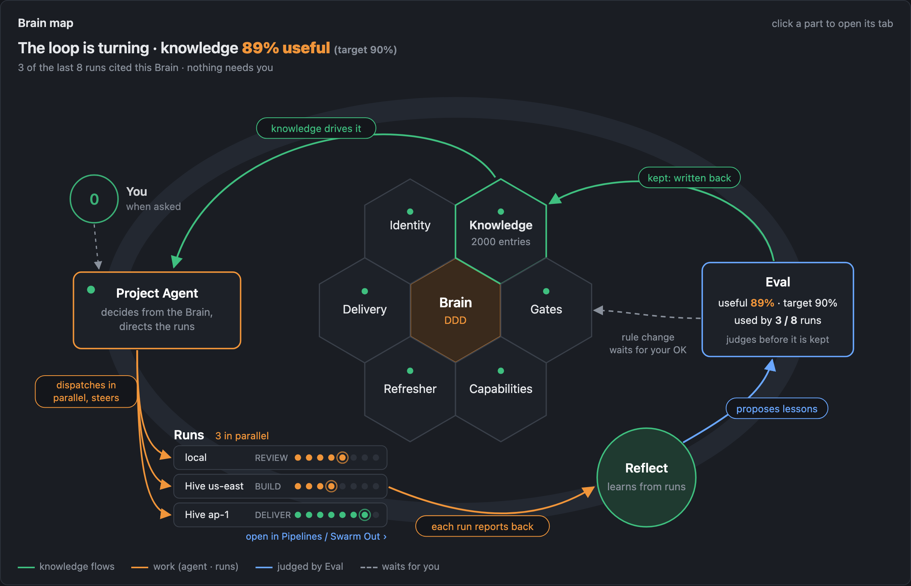
*The loop around a Brain: knowledge drives the Project Agent, which dispatches runs in parallel (locally or on Hives). Each run reports back, the lessons are judged, and what is kept is written back into the Brain. (Brain map design, illustrative numbers.)*

### Words used in these notes

| Term | What it means |
|---|---|
| **Brain** | A project's domain knowledge: what the project is, what was decided, how it is built, what went wrong. Kept as a **DDD**, one standard set of documents (product, tech, improvement, project) that every engine reads. |
| **General Brain** | The built-in Brain for knowledge that belongs to no single project; it is read in every project. |
| **Brain Hub** | The screen that shows every Brain, what it knows and what it learned. |
| **Project Agent** | A Brain's standard definition of how its work runs: which repos, which mode, which limits. |
| **Hive** | Your own SwarmAI running on an AWS machine, used as a worker that runs tasks in parallel. |
| **Swarm Out** | The feature (and the pinned tab) that sends a task to a Hive, follows it and brings the result home. |
| **CDF** | Cognitive Distillation Flow: the learning pipeline. Every session, pipeline run and Hive run sends what it learned to one inbox; CDF checks each item and writes it to the right Brain or memory file. |
| **Memory / Evolution** | The two files read in every session: lasting facts and decisions (Memory) and the agent's own corrections (Evolution). Only your own words or a measurement may enter them. |
| **Needs You** | The one queue of things that really wait on the person. |
| **North star** | The three numbers that say whether SwarmAI is getting better: how often you had to correct it, how often a correction repeats, and where mistakes come from. |
| **Pipeline** | The optional autonomous delivery mode: EVALUATE → THINK → PLAN → BUILD → REVIEW → TEST → DELIVER → REFLECT. **Gate-0** checks the diagnosis before building; **Gate-2** is the expert review; **FIXING_SPEC** is the one document that groups review findings by cause. |
| **Steer** | Typing into a turn that is still running; the agent reads it as part of that turn. |
| **Canvas** | The panel beside the chat that shows a session's files, changes and deliverables. |
| **Pollinate** | The content engine that turns one message into a media package. |

---

## 1 · Brain-driven: the Brain decides the work

**A Brain is a first-class product object, not a folder of documents.**

- **Brain Hub** has a layered home, and each Brain's page is a header plus seven tabs that mirror its six-section map. **New Brain** works end to end and fails early. It creates a standard initial DDD plus a Project Agent.
- **Two built-in Brains: SwarmAI and General.** The General Brain holds cross-project knowledge and is read in every project. A Brain holds knowledge only; runs belong to where they execute.
- **Project Agent: one standard definition per Brain**, confirmed by the agent itself, keeping only what a run uses. Dispatch reads it, so "which Brain, which mode" is the agent's default, not a question to the person.
- **Knowledge has an address.** [`SWARMAI.md`](https://github.com/xg-gh-25/SwarmAI/blob/main/backend/context/SWARMAI.md) says where each kind of knowledge lives and how to fetch it. **`cognition find / get / map`** is one read entrance for the whole brain: Brains, `Knowledge/`, MEMORY, EVOLUTION with archives, Timeline, context files, past sessions and the code graph.
- **Code intelligence is automatic once a Brain has a repo.** There is one way to build and update the graph. Python and Java get typed receivers and a "will break" check, the callers report reaches every review round and every Hive, and a pre-commit check refuses a staged change that breaks a caller.
- **Recall measures itself** (precision, coverage, follow-up budget). **DDD drift is fixed automatically** where the fix is certain, and the report says what was found and what was fixed.

Design: [built-in Brains and the Project Agent standard](https://github.com/xg-gh-25/SwarmAI/blob/main/docs/design/2026-10-29-default-brains-and-project-agent-standard.md) · [knowledge addressing](https://github.com/xg-gh-25/SwarmAI/blob/main/docs/design/2026-10-28-knowledge-addressing.md) · [the `cognition` entrance](https://github.com/xg-gh-25/SwarmAI/blob/main/docs/design/2026-11-01-cognition-entrance.md) · [code intel unification](https://github.com/xg-gh-25/SwarmAI/blob/main/docs/design/2026-10-29-code-intel-unification.md)

### Autonomous Pipeline v1: DDD-driven delivery from intent to a landed commit

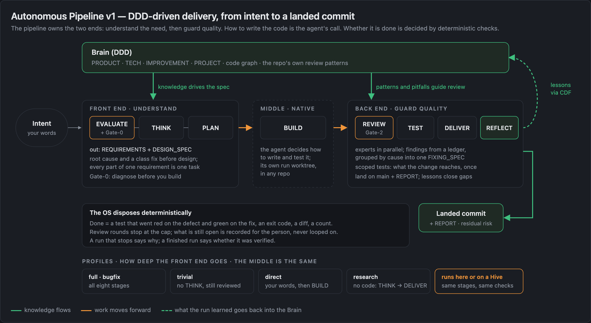

The pipeline was rebuilt around one rule: **it owns the two ends.** The front end understands the need (EVALUATE with Gate-0, THINK, PLAN → requirements and design spec). The back end guards quality (REVIEW with Gate-2, TEST, DELIVER, REFLECT). How the code is written is the agent's call. Whether it is done is decided by deterministic checks.

- **New event protocol and read model.** Commands run locally and the event log is checksummed.
- **Profiles set how deep the front end goes:** full, bugfix, trivial, direct (your words, then BUILD) and research (no code). The middle is the same for all of them.
- **Each run gets its own worktree** in any repo, and isolated runs land automatically while main keeps moving.
- **Deterministic convergence.** Gate-2 findings come from a ledger and are grouped by cause into one FIXING_SPEC. Review experts have their own agent type and a call cap and run in parallel. Rounds stop at the cap, and what is still open is recorded as residual risk for the person, never looped on.
- **Honest endings.** A run that stops says why, and a finished run says whether it was verified. Tests red on main are registered instead of lost. A person can answer, stop or resume a run, and the agent never answers for them.
- **REFLECT feeds the Brain.** A run's lessons go to CDF, and a run closes the gaps it fixed.

Design: [the pipeline owns the two ends](https://github.com/xg-gh-25/SwarmAI/blob/main/docs/design/2026-10-26-pipeline-two-ends.md) · [review convergence](https://github.com/xg-gh-25/SwarmAI/blob/main/docs/design/pipeline-review-convergence.md) · [one worktree per run](https://github.com/xg-gh-25/SwarmAI/blob/main/docs/design/pipeline-run-worktree.md)

---

## 2 · Autonomous, in parallel, in the cloud: Swarm Out

**One sentence in chat becomes a run on a Hive, and everything it produced comes home.**

- **A pinned Swarm Out tab** at the right end of the tab row. On the left is a live dashboard: the fleet, numbers, and run cards that trace Brain → Agent → Context → Hive → Report. On the right is a real chat session. The tab shows "N running / N waiting" badges, and the hive icon breathes while work is in flight.
- **Dispatch without a confirm click.** The agent picks the Brain, the Project Agent, the mode and the least busy Hive. A task a Hive cannot do is refused at intake.
- **The Hive works on this machine's code.** A task runs on this machine's commit of every repository in its Brain. The Hive daemon only keeps the bundle, and only the agent touches git.
- **Everything comes home in one sealed run record.** Commits come back as a bundle that is reviewed, then landed. Files the run wrote go into the run's Brain, every lesson goes straight into this machine's CDF, and the spend goes into the usage ledger.
- **The dispatching agent owns its runs.** It watches, posts one line per run change, gives a digest before your next message, and answers the Hive's waits for its own classes. Anything off-machine, irreversible or touching your data is never the agent's call: on a dispatched run it is refused, and the agent cannot approve it. Its commands are checked against the run, not against its word.
- **Run review at scale.** One run card everywhere, a run list, a big card and a five-command panel. One **operations registry** decides which command is allowed on which run and by whom, and the gate is generated from it.
- **A live Hive session tab** (Host proxy and relay) lets you open, watch or steer the remote session. A Hive pipeline run's decision reaches the Host.
- **History answers "is dispatched work reliable?"** It groups runs by Brain or Project Agent, shows how much came back done unattended, and draws one autonomy line over the last 30 days.
- **Worker Hives stay clean.** A worker Hive writes no cognition of its own, inherited cognition is set aside once, and recall and briefing are off on the fast path.
- **Zero-touch from New Brain to a finished Hive run**, plus seven E2E fixes for places a run could get stuck with no way out.

**The cloud side is usable by anyone with an AWS account.** A connect wizard sets up one pinned SwarmAI AWS account through `credential_process`, and the daemon, Bedrock and every Hive use it. An expired sign-in is fixed in one click from Settings. Bedrock model ids follow the main region (`eu-*` → `eu.`, `ap-*` → `apac.`, others → `global.`). A platform-wide **usage ledger** counts every token and dollar, including Hive spend and each pipeline run's share.

Design: [Swarm Out](https://github.com/xg-gh-25/SwarmAI/blob/main/docs/design/2026-10-27-swarm-out.md) · [the dispatching agent owns its runs](https://github.com/xg-gh-25/SwarmAI/blob/main/docs/design/2026-10-31-swarm-out-agent-owns-its-runs.md) · [zero-touch Brain to Hive](https://github.com/xg-gh-25/SwarmAI/blob/main/docs/design/2026-11-01-brain-to-hive-zero-touch.md) · [one SwarmAI AWS account](https://github.com/xg-gh-25/SwarmAI/blob/main/docs/design/2026-10-31-swarmai-aws-account.md) · [usage ledger](https://github.com/xg-gh-25/SwarmAI/blob/main/docs/design/2026-10-29-usage-accounting.md)

---

## 3 · Cognitive self-evolution: CDF

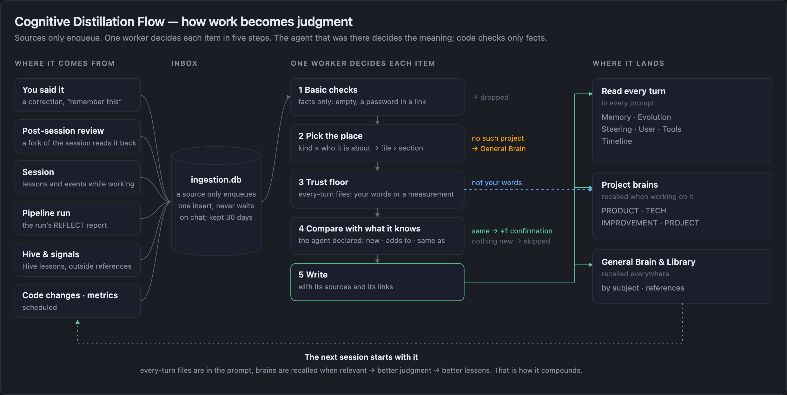
*The flow diagram shipped in Needs You → How it works, rendered from the app's own component.*

**CDF replaces the old memory and cultivation paths with one flow. The agent with the context decides; code checks facts.**

- **One flow, many doors.** Chat sessions, post-session reviews, pipeline runs, Hive runs, outside signals and code changes all enqueue into one inbox, and one worker decides each item in five steps. The old v1 pipeline, the legacy DDD cultivation path, the artifact registry and the signal-to-DDD bridge are deleted.
- **Each session is reviewed by its own agent and model, from its own record.** The producing agent declares what a unit is (new, adds to, same as, replaces, repeats a correction). CDF checks facts: the evidence exists, the target section exists, and there is no secret and no injected text. The second-guessing verify judge is gone.
- **Brain-driven files.** A Brain's main files are the current valid whole. Every change is an add, an override or a withdrawal, decided when the knowledge arrives, and history is kept outside the main files. A withdrawal does not come back.
- **Value first, no budgets.** There is no write quota and no injection budget, and MEMORY and EVOLUTION are injected whole. Size is kept down by declarations (same → one more confirmation, replaces → the old entry leaves), never by cutting.
- **A trust floor for every-turn files.** Only your own words or a measurement may enter MEMORY, EVOLUTION, Steering, User or Tools. Anything else is moved to a project Brain or the General Brain, never dropped.
- **Lessons compound.** The General Brain is found again in every project, a repeated lesson reaches EVOLUTION, and a gap closes when an event says it is done. Open work becomes a ToDo instead of a "Next" line.
- **Mistakes become a ledger.** The person picks a correction's class, and the repeat rate is a count, not a model's guess. A sent-back Hive delivery counts as a correction too.
- **You can see it work.** Needs You has a **Cognition flow view** (what landed, where, through which step), a **Health tab** (is what CDF keeps useful, is CDF healthy, what it costs) and **Swarm's cognition level**. Brain Hub has a **change feed** (what a Brain learned, read from CDF's records instead of git).
- **The north star is in every prompt.** It tracks three measures: how often the person had to correct Swarm, how often a correction repeats, and where mistakes come from. They are defined in [`SWARMAI.md`](https://github.com/xg-gh-25/SwarmAI/blob/main/backend/context/SWARMAI.md), shown as a headline in every prompt, and the detail is one command away ([`scripts/north_star.py`](https://github.com/xg-gh-25/SwarmAI/blob/main/backend/scripts/north_star.py)). Progress means fewer corrections and fewer repeats, not more stored entries.

Design: [Cognitive Distillation Flow](https://github.com/xg-gh-25/SwarmAI/blob/main/docs/design/2026-10-26-swarm-cognitive-distillation-flow.md) · [the agent with the context decides](https://github.com/xg-gh-25/SwarmAI/blob/main/docs/design/2026-10-30-cdf-agent-decides.md) · [Brain-driven files](https://github.com/xg-gh-25/SwarmAI/blob/main/docs/design/2026-10-30-brain-driven.md) · [CDF health](https://github.com/xg-gh-25/SwarmAI/blob/main/docs/design/2026-10-31-cdf-health.md)

### The read side: how the brain reaches every judgment

Writing knowledge down is only half of self-evolution. The other half is putting the right piece in front of the agent at the moment it decides. In v2.4.0, every place where work happens reads the same brain, through five doors:

| Door | When it fires | What arrives |
|---|---|---|
| **Every-turn context** | Every session; the system prompt is assembled fresh from the governed files | Principles and rules, your profile and standing rules, Memory and Evolution in full, the last two days of DailyActivity, monthly Timeline summaries and the north-star headline. |
| **Automatic recall** | At session start and on each new message that carries search words | A `[RECALLED]` block from the Knowledge Library and past sessions (keyword / FTS5 / BM25 search, no vector store), filtered for precision; older activity needs more matching words before it is shown. |
| **DDD recall** | When the session's project is detected: a bound repo it touched, a project path, a project skill or a project keyword (ambiguous means no project) | A `[DDD:<project>]` block that points to the Brain entries that bear on the task, with `file:line`, so the agent opens the source instead of trusting a summary. |
| **The `cognition` CLI** | Whenever the agent decides it needs to know | `cognition find / get / map` searches every store with the words of the solution, not only the words of the request: Brains, Knowledge, Memory, Evolution and their archives, Timeline, context files, past sessions and the code graph. The agent is told to use it before saying "I don't recall" and before judging anything about its own system. |
| **Repository guidance** | The first time a session touches a repository | The repo's own `AGENTS.md`, `CLAUDE.md`, `.swarmai/review.md` and its lessons from earlier pipeline runs. A repo bound to a Brain is treated as that project's norms; any other repo's guidance is checked with the person before it changes how work is done. |

**In a pipeline run, knowledge is delivered by the run itself, not left to chance.**

- **At create**, the run writes `knowledge.md`: the project's product and decision entries plus relevant Library knowledge, read by EVALUATE.
- **After EVALUATE**, it writes `knowledge_design.md`: the technical and improvement entries plus this repository's lessons from earlier runs, read by THINK and PLAN.
- **Every recalled item has an id** that goes into the run's protected contract, so a requirement or design that cites knowledge (`knowledge_refs`) is checked against what was actually recalled.
- **In REVIEW**, the correctness expert gets a project-knowledge section recalled for the changed files, plus the code graph's report of the callers a change can break. A finding may cite a knowledge id.
- **REFLECT closes the loop**: the run's lessons go back into the brain through CDF.

**On a Hive**, the worker reads the Brain and the General Brain synced from this machine. Its `cognition` searches only Brains and code, and nothing it learns stays on the Hive.

**Every unit arrives whole.** Recall decides which entries to show and never cuts one short. An entry that does not fit is named with its location and length, so the agent can open it.

Design: [Pipeline run knowledge](https://github.com/xg-gh-25/SwarmAI/blob/main/docs/design/2026-10-26-run-knowledge.md) · [Recall precision and coverage](https://github.com/xg-gh-25/SwarmAI/blob/main/docs/design/2026-10-26-recall-precision-and-coverage.md) · [Knowledge delivery gaps](https://github.com/xg-gh-25/SwarmAI/blob/main/docs/design/2026-10-25-knowledge-delivery-gaps.md) · [Knowledge addressing](https://github.com/xg-gh-25/SwarmAI/blob/main/docs/design/2026-10-28-knowledge-addressing.md) · [The `cognition` entrance](https://github.com/xg-gh-25/SwarmAI/blob/main/docs/design/2026-11-01-cognition-entrance.md)

---

## 4 · The foundation: faster and steadier

**This release removes the causes of slowness instead of adding timeouts around them.**

- **CDF lives with chat, not against it.** A quadratic byte-offset function was the real cost. Parsing a 946 KB DDD file went from **999 ms to 23 ms**, and parsed spans are cached by path, mtime and size. With that fixed, the streaming gate that starved CDF all day was removed.
- **ReDoS fixed in the tool-call-leak strip.** One regex was quadratic: a 240 KB input took 3.7 s and now takes 14 ms. It ran on the event loop and was reachable from user messages.
- **The event loop is kept free.** Run.json scans, `/artifacts/drift`, the blocking Bedrock judges and run-record I/O moved off the loop. Starvation now logs the loop thread's stack, the power source and the battery level.
- **Leak turns continue in-process** instead of dead-ending, and leak-poisoned transcripts are cleaned so `--resume` does not replay them.
- **Streaming admission** queues a new turn only under real memory pressure; there is no fixed stream cap. Prompt-cache writes use the one-hour tier, and TTFT is measured to the model's first output.
- **Fewer round trips per turn.** Hooks nudge the model to batch independent tool calls and to keep a slow run's whole output instead of re-running it.
- **UI.** A streamed token no longer re-renders every finished tool row, and Canvas changes never re-render the message list. Every overlay is its own chunk loaded on nav hover, with a first-bundle size cap. npm provisioning moved off startup and tree-sitter is pre-warmed.
- **Pipeline speed.** Tests are selected by what the change reaches, not by every importer: for one `session_unit.py` change, 94 files → 9. Unchanged files are reused by content hash, and workers scale to idle cores and share one pool. `stage-start` / `stage-complete` replace 3–5 model calls per stage. Gate-2 round 2 sees only the fix, and re-entering DELIVER re-reviews only the delta.

Design: [CDF and chat coexistence](https://github.com/xg-gh-25/SwarmAI/blob/main/docs/design/2026-10-29-cdf-chat-coexistence.md) · [pipeline speed](https://github.com/xg-gh-25/SwarmAI/blob/main/docs/design/pipeline-speed-systematic-fix.md) · [pipeline test speed](https://github.com/xg-gh-25/SwarmAI/blob/main/docs/design/pipeline-test-speed.md)

### Chat

- **Steer, on by default.** A message sent while a turn runs goes into that turn, and its bubble shows Waiting, Read, or Queued with the reason.
- **One backend fact for "a turn is in progress".** The send queue lives in the backend, so an unaccepted message says "Not sent · Retry". After 45 s of quiet, the turn says what it is waiting on.
- **A calmer turn display.** Process prose recedes and finished steps fold by kind. Cards that wait on you share one frame, and each turn's code changes show as one diff card. Stop leaves a receipt that Continue resumes from, and Opus thinking is visible on Bedrock.
- **Super Canvas** shows Artifacts and Changes per session. It previews Office files, Jupyter, mermaid and HEIC / TIFF, the agent can open, fold and switch it without disturbing chat, and the terminal has add-to-chat.
- **Welcome screen v2**, one brand, one nav visual system and a unified inbox dock.

Design: [steer](https://github.com/xg-gh-25/SwarmAI/blob/main/docs/design/2026-10-24-chat-steer.md) · [turn liveness](https://github.com/xg-gh-25/SwarmAI/blob/main/docs/design/chat-turn-liveness.md) · [Super Canvas](https://github.com/xg-gh-25/SwarmAI/blob/main/docs/design/super-canvas.md)

### Security: one authorization model, one API registry, usable by anyone

Autonomy only works if it is always clear who may decide what. This release adds one rule for that and one place where it is written down.

**One authorization model: whoever dispatches the work answers for it.**

- **Authority follows delegation.** A person answers for what they run or dispatch. An agent that dispatches workers answers for them: it handles their waits, records each decision as its own (never as the person's), and escalates what it cannot handle. It may never decide more than it could do itself without asking, so anything off-machine, irreversible or touching the person's data still goes to the person. This is now part of SwarmAI's governed principles (principle P5 in `SOUL.md`).
- **Every wait carries an approval class.** When a Hive stops to ask, the gate that stopped it computes the class from its own facts: a question, a decision, a Hive-local action, a run authorization, or a person-only class such as remote code, an irreplaceable data store or an unknown pattern. The dispatching agent may answer only the agent classes. It answers through the CLI, and only with an option on a card it built for that very wait. The Hive's bridge refuses an agent answer outside those classes (`not_host_class`). Everything unclear fails closed into a person-only class: compound shell commands, `sudo`, user-added patterns, and older Hives that do not send a class. On a dispatched session, a person-only action is refused on the spot instead of waiting, so no run sits stuck waiting for a person.
- **Every answer says who gave it.** Answers carry `answered_by: person | host`. An agent's answer is counted as the agent's decision, never as human approval, and the run card lists each one with its reason. An agent-class wait nobody handles within 10 minutes is raised to Needs You, naming the session it belongs to.
- **Pipeline runs have an owner.** Every mutating pipeline command is bound to one project and one run. A session takes over a run only when the owner session is idle, and every human authorization follows the new owner. The agent can never give an answer that belongs to the person.
- **Approval prompts you can trust.** A prompt appears only for what the command does not answer itself. A prompt is never lost: it is stored with its turn, shown again, and expires honestly. An approval reaches only the exact command the person was shown.

**One API registry for Swarm Out and Hive management.**

- **Every operation is one row.** Each HTTP operation under `/api/swarm-out`, `/api/hive` and `/api/aws-account`, plus every Host-proxy route to a Hive, is a row in one table ([`swarm_out_ops.py`](https://github.com/xg-gh-25/SwarmAI/blob/main/backend/core/swarm_out_ops.py)) that says who may call it: the person (the desktop App), the owner's agent, or internal backend code. It works like an API gateway for everything that dispatches, commands or manages Hives.
- **The gate is generated from the table, and tests hold it complete.** The agent-side gate is built from the registry, so a person-only route cannot be left out by hand. A route the app serves without a row turns the test red. Person-only paths are refused in their encoded, `..` and quote-split spellings. The agent's `swarm_out` CLI may call only the operations the agent may call, and the agent's commands on a run always go through that CLI, never through a raw HTTP call.
- **Honest scope.** The gate reads command text, and the agent and the daemon run as the same OS user. So today "person-only" stops mistakes and casual misuse; it is not yet a hard boundary against a determined agent. A person-signature phase for that boundary is designed.

**Usable by anyone, safely.**

- **Product code no longer assumes SwarmAI's own repo, machine or project**, and closed-world tests keep it that way.
- **Non-owner channel sessions are contained.** An egress proxy lets them reach only public addresses, and they get an MCP allowlist and WebFetch limits. A non-owner session can never call Swarm Out. STEERING shares only the text its owner marks for channels.
- **Secrets and injection.** Slack tokens live in the macOS Keychain. Terminal buffer text moved from the system prompt to the user turn, and every write-time guard pattern runs in linear time.
- **Desktop hardening.** The webview gets no shell permission, files open in the browser from a read-only content origin, and the web inspector is off unless the app starts with `SWARMAI_DEBUG`.

Design: [Hive approvals by chain of responsibility](https://github.com/xg-gh-25/SwarmAI/blob/main/docs/design/2026-10-31-hive-approvals-person-and-host.md) · [Swarm Out operations registry](https://github.com/xg-gh-25/SwarmAI/blob/main/docs/design/2026-10-31-swarm-out-ops-registry.md) · [when "only a person can do it" becomes a boundary](https://github.com/xg-gh-25/SwarmAI/blob/main/docs/design/2026-10-31-human-proof-verification.md) · [SwarmAI usable by anyone](https://github.com/xg-gh-25/SwarmAI/blob/main/docs/design/2026-10-24-swarmai-usable-by-anyone.md)

---

## 5 · A tour of the new UI

The screens follow the same loop as the release: you start, the Brain decides, work runs in parallel, and the system shows how it is learning. (Screenshots from a real install; private Brain names, local paths and account totals are blurred.)

### Welcome: one brand, one queue

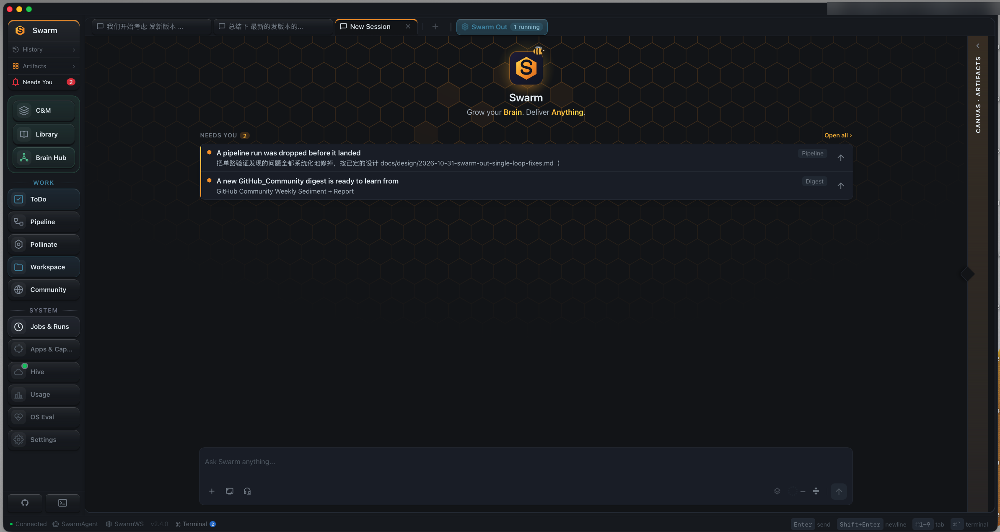

A new session opens on the logo, the line *Grow your Brain. Deliver Anything.* and one **Needs You** queue: only the things that really wait on you, written for you rather than for the agent. One click fills the chat input, and ↑ sends it now. The left nav groups everything into three zones: Cognition (C&M, that is Context & Memory, plus Library and Brain Hub), Work and System.

### Brain Hub: every Brain at a glance

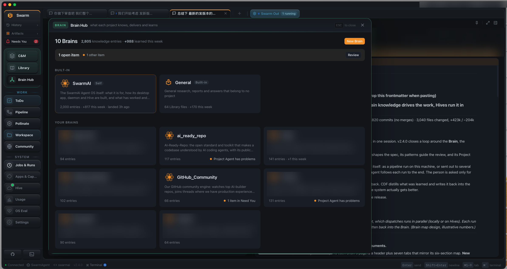

The Hub home shows how much all your Brains know and how much they learned this week. The two built-in Brains (SwarmAI and General) sit on top, with your own Brains below. Each card says what the Brain is for, how many entries it holds and whether something needs attention, such as a Project Agent with problems. **New Brain** starts a Brain end to end.

### A Brain's page: the loop, live

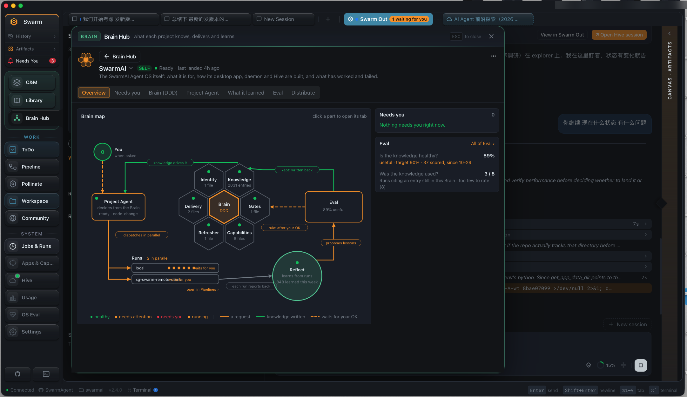

Each Brain has seven tabs: Overview, Needs you, Brain (DDD), Project Agent, What it learned, Eval and Distribute. The Overview's **Brain map** draws the loop from section 1 with live data: the six sections of the DDD, the Project Agent, the runs under way in parallel (here one local and one on a Hive), Reflect, and Eval with how useful the knowledge is against its target.

### Chat and Canvas: the work and its result side by side

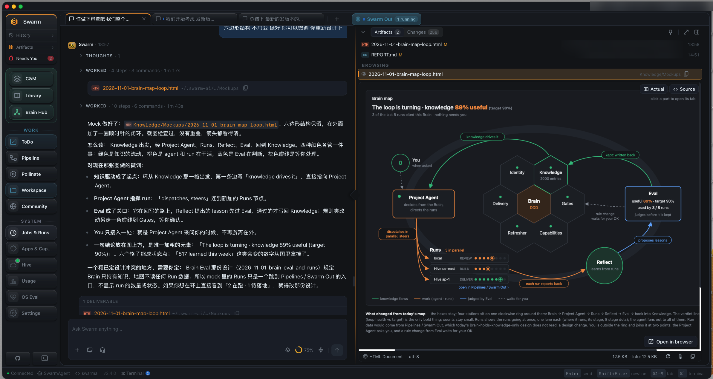

A finished turn folds its process into short "Worked · N steps" rows and ends with its deliverables. The Canvas on the right shows this session's Artifacts and Changes. Here it renders an HTML file the turn just wrote, with an Actual / Source switch and Open in browser.

### Swarm Out: dispatch and follow work on your Hives

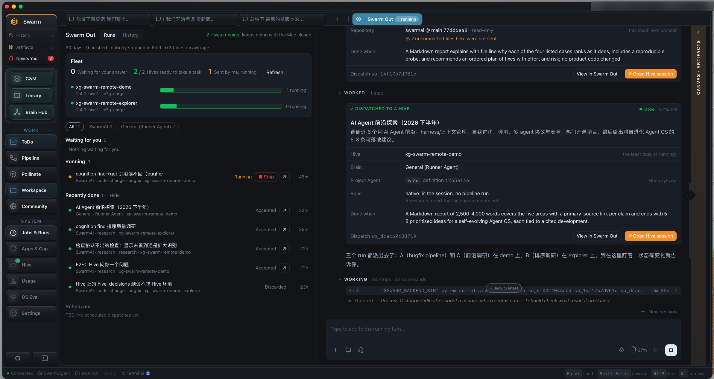

The pinned **Swarm Out** tab. On the left: the fleet (which Hives are up and how busy they are), what is waiting for you, what is running (with Stop) and what came back, each run named with its Brain, mode and Hive. On the right: the dispatching chat, where each dispatch card records the repository and commit sent, the done-when condition, the Hive, the Brain, the Project Agent and how it runs, with **Open Hive session** one click away.

### A Hive session: the remote run, in its own tab

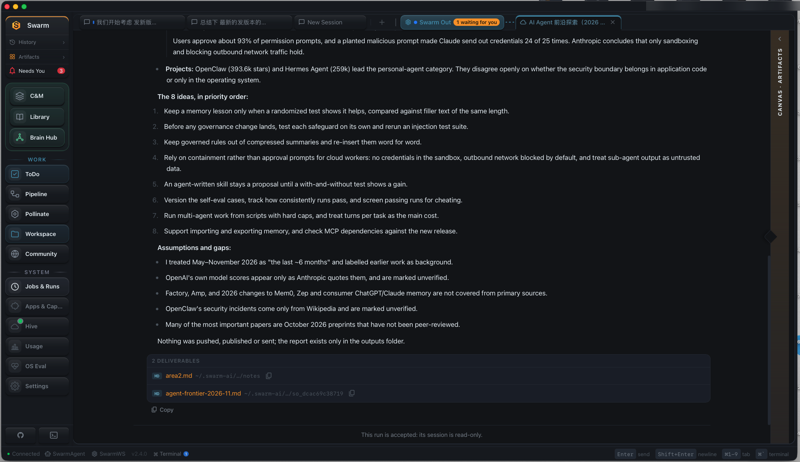

Opening a run shows the Hive's own session as a tab on this machine. Here a research run delivered its report. Its deliverables are listed as files, and once the result is accepted the session turns read-only, so the record cannot change after the decision.

### Swarm's cognition: is it needing you less?

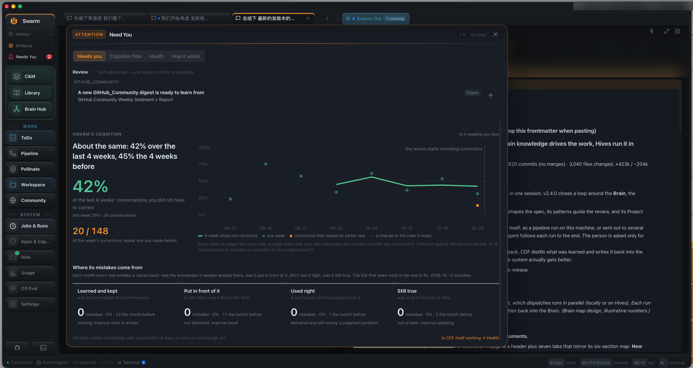

Under Needs You, **Swarm's cognition** answers the north-star question with one headline. It shows the share of recent conversations you did not have to correct, the week-by-week trend, and how many corrections repeat an earlier one. Below, **Where its mistakes come from** traces each real mistake to one of four links: the knowledge was missing, was not put in front of the agent, was not used right, or was out of date.

### CDF Health: is what it keeps worth keeping?

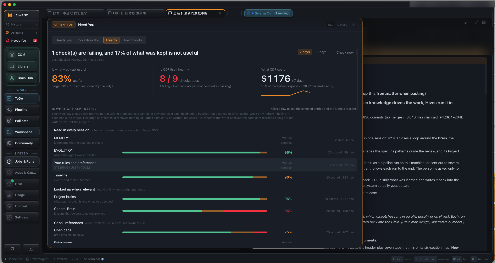

The **Health** tab judges CDF itself in three numbers: how much of what was kept is useful, how many of CDF's own checks pass, and what CDF costs. Below, a judge that took no part in writing scores a sample of new entries for each destination against that destination's own target. Every-turn files have a higher bar than project Brains, because a bad entry there misleads every turn.

---

## Upgrade notes

- **Skill visibility.** A skill is owner-only only when its `SKILL.md` frontmatter says `visibility: internal`. A skill's name no longer makes it private, so add the field to every skill you want to keep private before upgrading.
- **AWS account.** The setup wizard asks you to connect one SwarmAI AWS account, which the daemon, Bedrock and Hives then use.
- **Chat always runs on Bedrock.** Anthropic-direct API keys are no longer supported. An install that chatted through an Anthropic key is switched to Bedrock on upgrade; the saved key is kept, unused. Connect an AWS account or a Bedrock API key in Settings → Swarm AWS Account.
- **Slack credentials** move to the macOS Keychain and are no longer written to config.
- **Steer is on by default.** To turn it off, change the `steer_busy_send` setting.
- **Bedrock model ids** now use the region prefix of your main region. Check Settings → LLM Models if you pinned a model id.
- **Pipeline:** new runs use the v1 event protocol.

---

Figures: the PNGs live next to this file in [`docs/releases/v2.4.0/`](https://github.com/xg-gh-25/SwarmAI/tree/main/docs/releases/v2.4.0); the HTML sources of figures 2–4 are in [`src/`](https://github.com/xg-gh-25/SwarmAI/tree/main/docs/releases/v2.4.0/src).

🐝 Generated with SwarmAI
